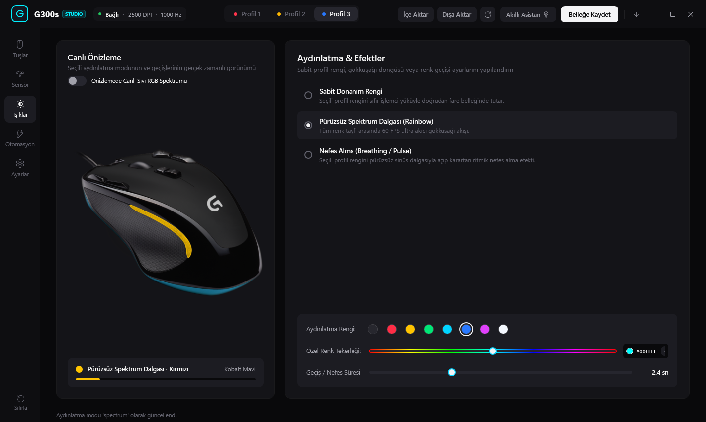
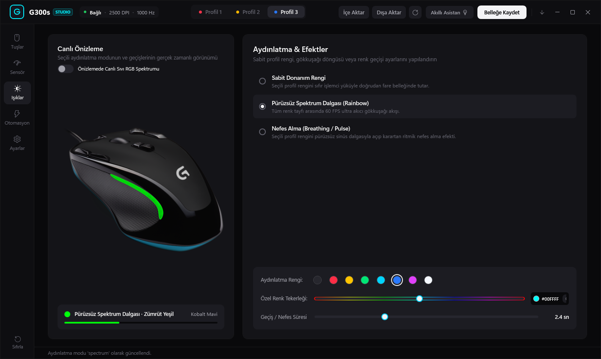
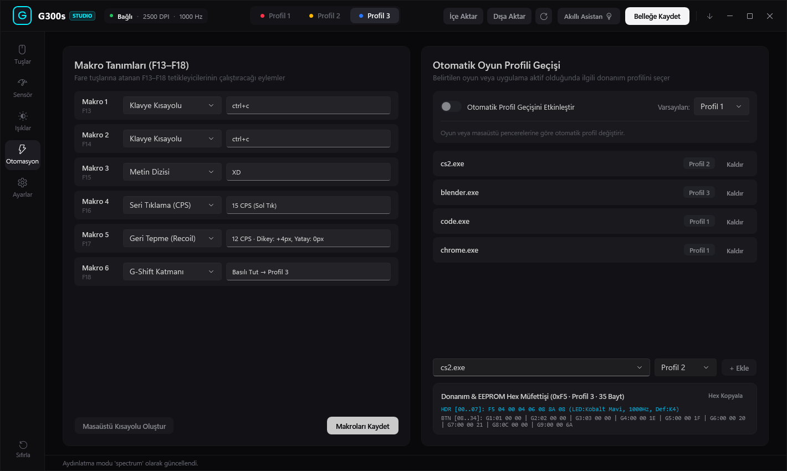
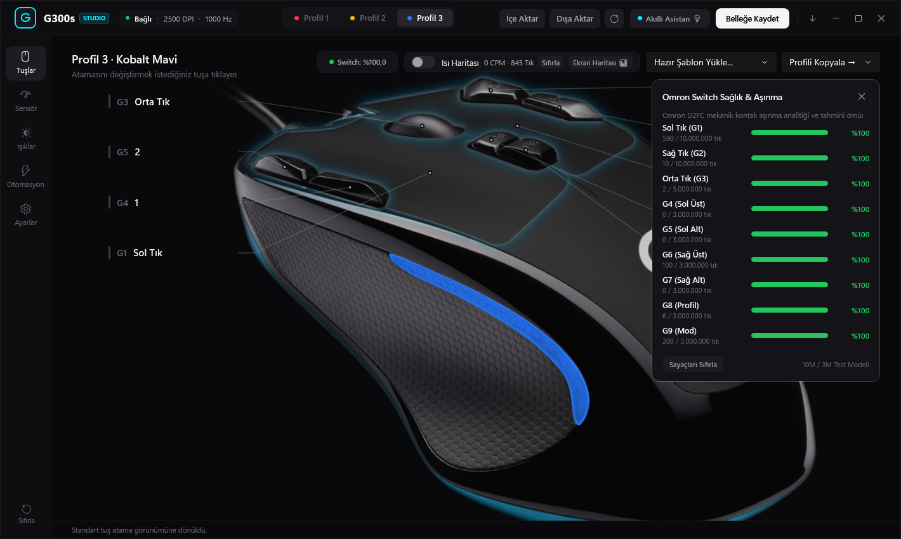
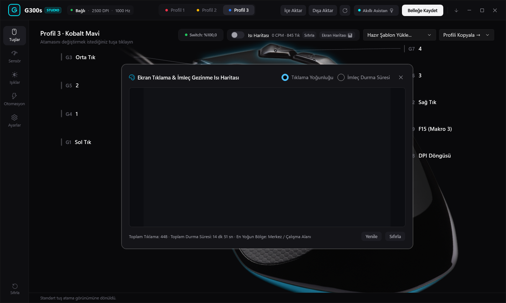
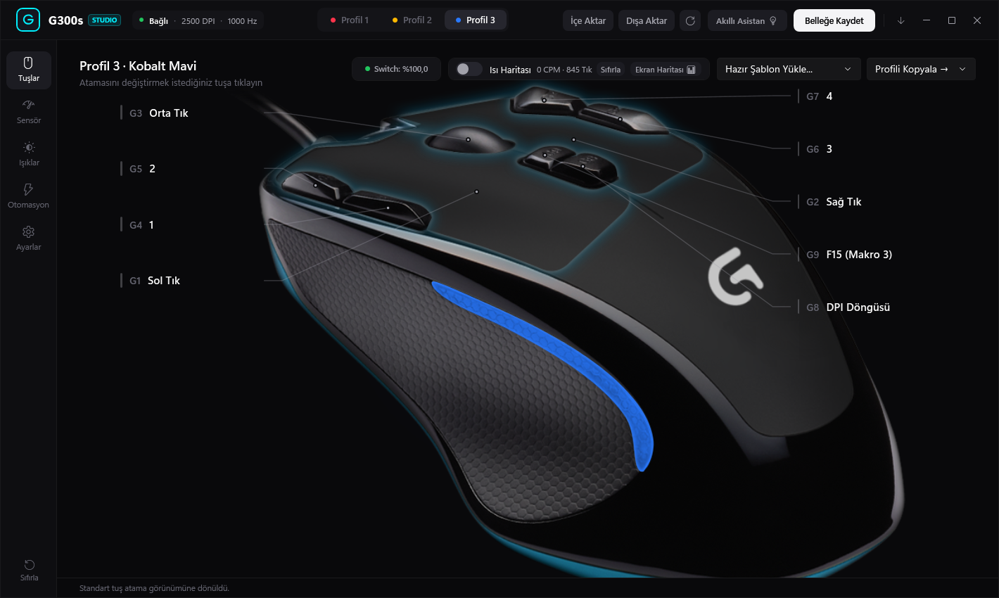
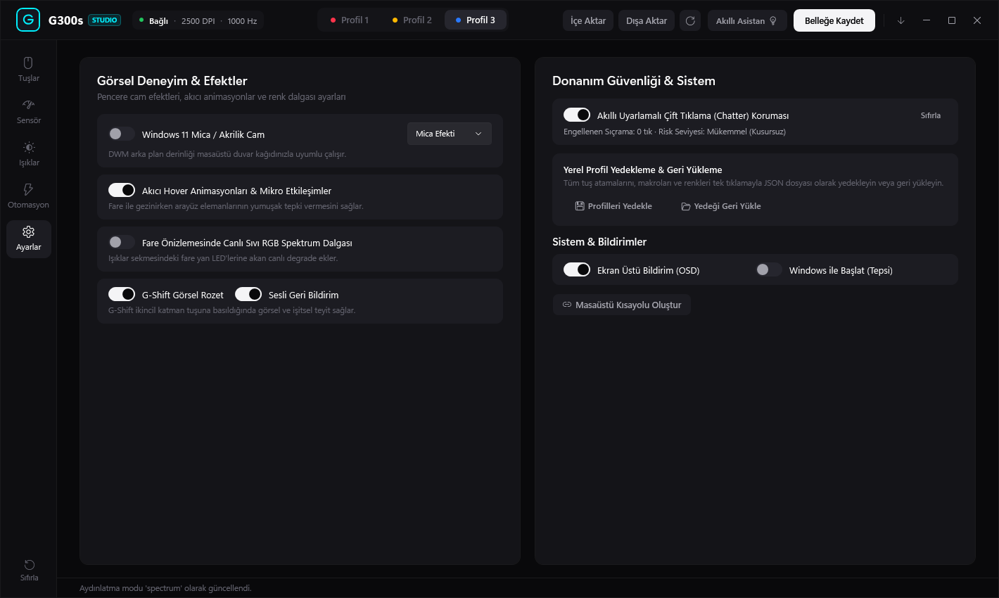

# ⚡ Logitech G300s Studio

<div align="center">


-107C41?style=for-the-badge)


<p align="center">
  <b>A modern, high-performance, open-source replacement for Logitech Gaming Software (LGS).</b><br>
  Engineered specifically for the iconic <b>Logitech G300s Optical Gaming Mouse</b> (<code>VID: 0x046D, PID: 0xC246</code>).<br>
  Direct Win32 USB HID communication, Windows 11 Mica/Acrylic backdrops, 2D Radial RGB wheel, live screen & button heatmaps, physical switch wear analytics, and intelligent real-time usage recommendations.
</p>

[📥 Download Latest Portable Exe](https://github.com/furkan-izgi/logitech-g300s-studio/releases/latest/download/LogitechG300sStudio.exe) • [✨ Key Features](#-features--capabilities) • [📸 Screenshots](#-visual-tour) • [📊 HID Protocol](#-reverse-engineered-hardware-protocol) • [🛠️ Build Guide](#-building-from-source)

</div>

---

## 🖼️ Main Application Stage

<div align="center">
  
  <p><i>Figure 1: Logitech G300s Studio Main Hardware Stage featuring photorealistic SVG/PNG mouse model, dynamic side LED swoosh glow, and interactive button mapping pins.</i></p>
</div>

---

## ⚡ Highlights & Key Innovations

* 💎 **Windows 11 Native Mica & Acrylic Design**: Sleek dark-mode aesthetic integrating Windows DWM (`DwmSetWindowAttribute`) system materials, zero-caption frameless drag, fluid micro-interactions, and neon accent tokens.
* 💾 **Direct Onboard Flash Memory Control**: Read, tune, and flash all 3 hardware profiles (`0xF3`, `0xF4`, `0xF5`) directly into the mouse's internal EEPROM. Discover and respect the internal hardware busy lock flag (`0xF0` bit 3) to prevent write-corruption.
* ⚡ **Instant Live RAM Operations (Zero Flash Wear)**:
  * **Live LED (`0xF1`)**: Switch RGB lighting dynamically in volatile RAM without wearing out physical EEPROM write cycles.
  * **Live Report Rate (`0xF2`)**: Dynamically switch USB polling rate (125 Hz, 250 Hz, 500 Hz, 1000 Hz) instantly.
* 🎨 **2D Radial HSV Color Wheel & 24-Bit Smooth Lighting**: Choose any custom 24-bit intermediate hue with full spectrum breathing and liquid color transitions.
* 🔍 **Switch Health & Mechanical Wear Analytics**: Real-time tracking of Omron D2FC mechanical switch actuations against their 10,000,000-click rated lifespan. Integrated double-click/chatter detection and software debounce filtering.
* 🗺️ **Dual-Engine Heatmap Analytics**:
  * **Physical Button Heatmap**: Visualize click concentration across G1–G9 with hot-spot color gradients.
  * **Screen Dwell & Click Heatmap**: Track cursor dwell times and spatial click densities across desktop monitors.
* 💡 **Smart AI Usage Advisor**: Real-time telemetry engine evaluating polling consistency, click fatigue, and macro utilization, providing actionable tuning suggestions.
* ⌨️ **Hardware Limit Bypass via High Function Keys (`F13..F24`)**: Overcomes the mouse's 1-key boot-keyboard limit by mapping physical buttons to unallocated keys `F13..F24`, executing multi-step macros, text sequences, and rapid-fire auto-clickers with zero key collisions.
* 📦 **Self-Contained Single-File Binary**: Zero installer, zero dependencies, no separate .NET runtime required—just run `LogitechG300sStudio.exe`.

---

## 📸 Visual Tour

### 🎯 Sensor Tuning & DPI Curves
Adjust 4 distinct DPI stages (250 to 2500 DPI, in 250 DPI micro-steps) with interactive curve visualizations, default stage toggling, and independent USB report rates (125, 250, 500, 1000 Hz).
<p align="center"></p>

---

### 🌈 RGB Lighting Studio & 2D Radial Color Wheel
Full 8-color hardware palette selection, instant RAM preview, custom 24-bit intermediate hue slider, smooth liquid rainbow wave, breathing effects, and a 2D Radial HSV Color Wheel modal.
<p align="center"></p>
<p align="center"></p>

---

### 🤖 Host Automation & Macro Engine
Automatic active-window profile switching (`AppWatcher`), customizable rapid-fire clickers, crosshair overlays, sniper DPI toggle, and multi-key macro expansion.
<p align="center"></p>

---

### 🛠️ Switch Health & Mechanical Wear Analytics
Monitor individual switch actuations, lifetime percentage wear against Omron 10M ratings, and activate software chatter/debounce filters.
<p align="center"></p>

---

### 🗺️ Screen Dwell & Click Heatmap
Spatial visualization of cursor resting zones and click hotspots across displays with dwell-time gradient overlays.
<p align="center"></p>

---

### 💡 Smart Usage Advisor
Autonomous assistant observing mouse telemetry and recommending optimal DPI stages, macro adjustments, and switch maintenance reminders.
<p align="center"></p>

---

### ⚙️ Studio Settings & Diagnostics
Configure Windows 11 Mica/Acrylic backdrops, start-with-Windows minimization to system tray, OSD notification toasts, and hardware backup wizards.
<p align="center"></p>

---

## 📋 Reverse-Engineered Hardware Protocol

The Logitech G300s communicates over USB HID vendor usage page `0xFF80` with report ID `0x0080`:

| Report ID | Size | Type | Description |
| :---: | :---: | :---: | :--- |
| **`0x80`** | 5 B | Input | Asynchronous physical button press notifications (`[0x80, state, 0, 0, action_code]`) |
| **`0xF0`** | 4 B | Feature | Read/Write active profile (`bits 7..4`), DPI level (`bits 2..1`), and Flash Busy Lock (`bit 3: 0x08`) |
| **`0xF1`** | 2 B | Feature | Instant Live RAM RGB LED color (`[0xF1, (r) \| (g << 1) \| (b << 2)]`) |
| **`0xF2`** | 2 B | Feature | Instant Live RAM USB Polling Rate (`[0xF2, 0x04 \| rate_code]`) |
| **`0xF3`** | 35 B | Feature | Onboard Profile 0 Flash Memory dump / write |
| **`0xF4`** | 35 B | Feature | Onboard Profile 1 Flash Memory dump / write |
| **`0xF5`** | 35 B | Feature | Onboard Profile 2 Flash Memory dump / write |

### 35-Byte Onboard Profile Layout
```
Offset  0: Report ID (0xF3, 0xF4, 0xF5)
Offset  1: LED color (bit 0=Red, bit 1=Green, bit 2=Blue)
Offset  2: Report rate code (0=1000Hz, 1=125Hz, 2=250Hz, 3=500Hz)
Offset 3-6: 4 DPI levels (value = (byte & 0x7F) * 250; bit 7 indicates default level)
Offset  7: Hardware calibration byte (0x40)
Offset 8-34: 9 physical buttons (3 bytes each: [action_code, modifier_mask, hid_key_code])
```

---

## 🚀 Download & Installation

### Option 1: Standalone Portable Executable (Recommended)
No installation or dependencies required:
1. Download **[`LogitechG300sStudio.exe`](https://github.com/furkan-izgi/logitech-g300s-studio/releases/latest/download/LogitechG300sStudio.exe)** from the latest release.
2. Run the executable. It automatically connects directly to the mouse via Win32 HID APIs.

### Option 2: Python CLI & Linux Daemon
```bash
# Clone the repository
git clone https://github.com/furkan-izgi/logitech-g300s-studio.git
cd logitech-g300s-studio

# Install package in development mode
pip install -e .

# Run CLI
g300s info
g300s save backup.json
```

#### Linux udev Rules (for non-root USB access)
```bash
sudo cp udev/99-logitech-g300s.rules /etc/udev/rules.d/
sudo udevadm control --reload-rules && sudo udevadm trigger
```

---

## 🛠️ Building from Source

### Requirements
* Windows 10/11
* .NET 10 SDK or higher
* PowerShell 7+ (optional for helper script)

```powershell
# Restore and publish self-contained single-file executable
dotnet publish native/G300sController/G300sController.csproj `
    -c Release `
    -r win-x64 `
    --self-contained true `
    -p:PublishSingleFile=true `
    -p:IncludeNativeLibrariesForSelfExtract=true `
    -p:IncludeAllContentForSelfExtract=true `
    -p:EnableCompressionInSingleFile=true `
    -o dist/
```
The compiled, portable executable will be placed at `dist/LogitechG300sStudio.exe`.

---

## 🤖 Continuous Integration & Automated Builds

Every commit pushed to `master` automatically triggers the [GitHub Actions CI/CD pipeline](.github/workflows/build-release.yml).
* Compiles the full self-contained single-file executable on `windows-latest`.
* Packages artifacts into `LogitechG300sStudio.zip`.
* Updates the rolling **[Latest Continuous Release](https://github.com/furkan-izgi/logitech-g300s-studio/releases/tag/latest)** with direct download links.

---

## 📜 License

This project is licensed under the **MIT License**. See [LICENSE](LICENSE) for details.

*Disclaimer: This is an independent open-source project and is not affiliated with, endorsed by, or sponsored by Logitech.*
