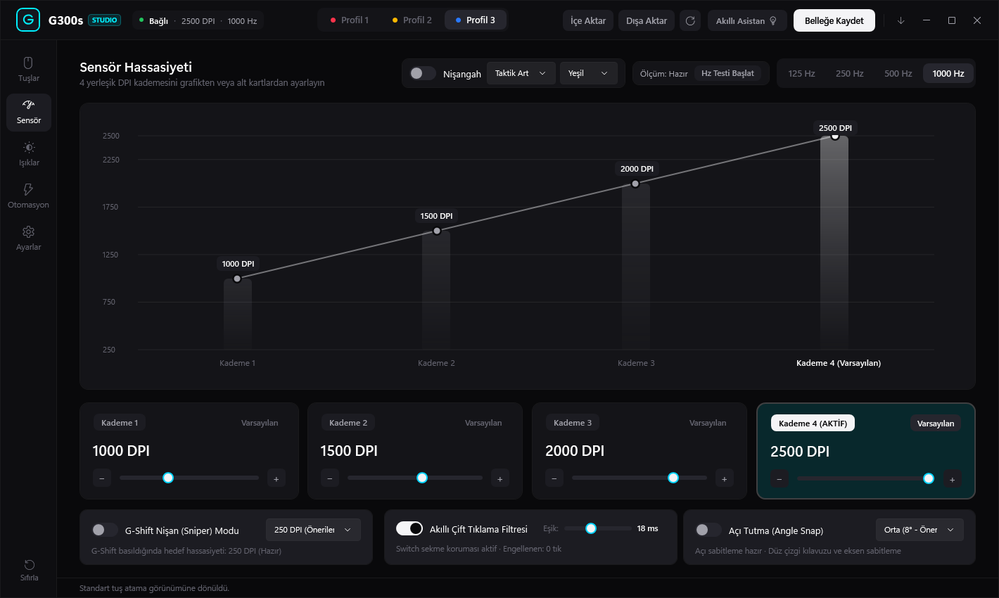
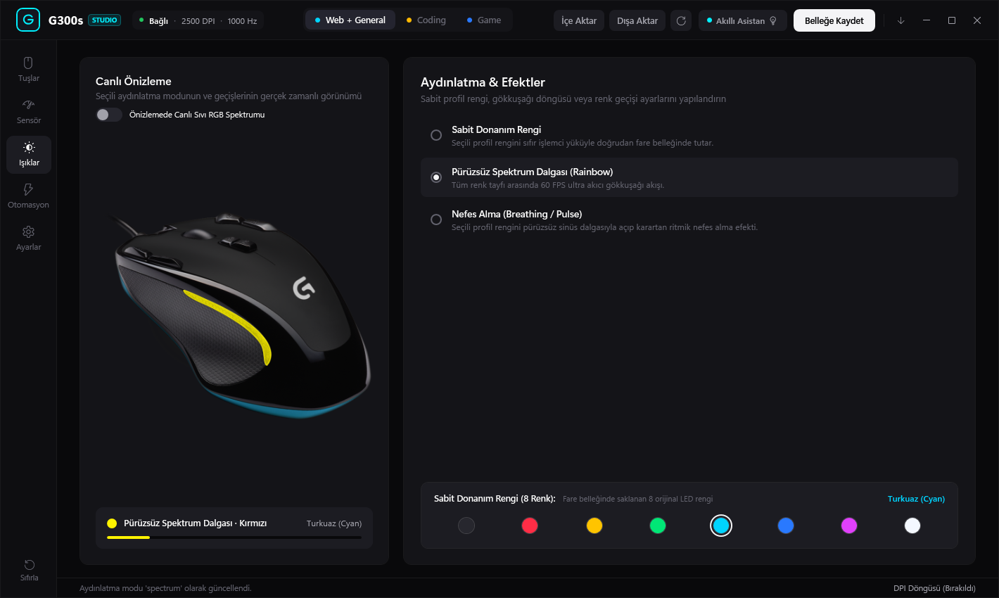
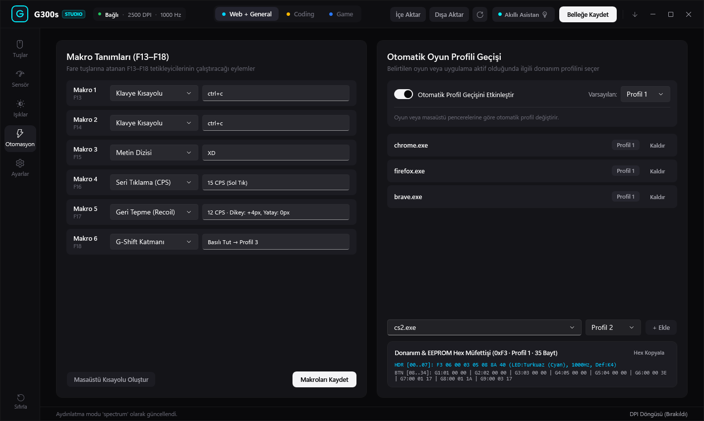
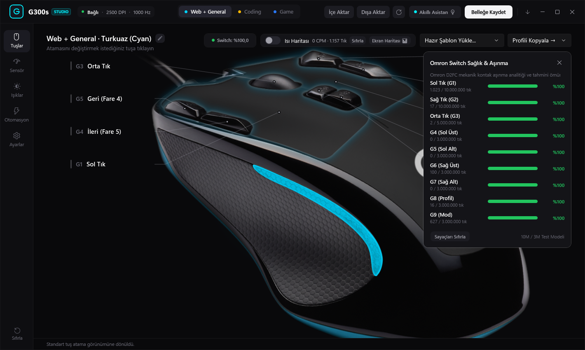
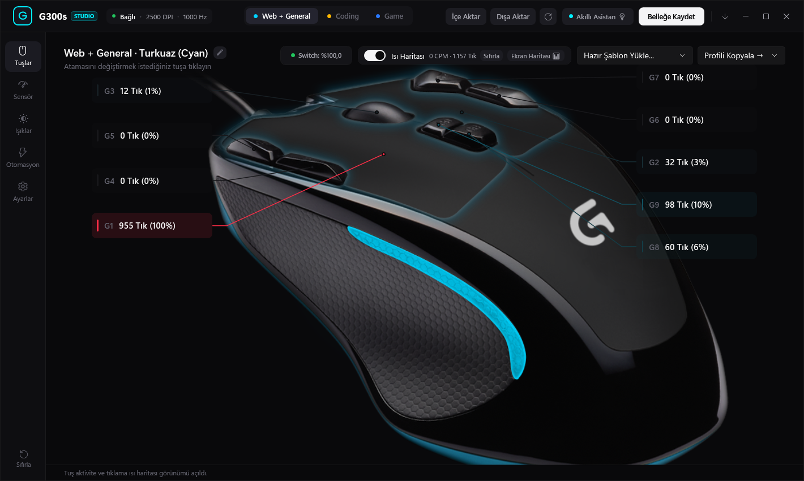
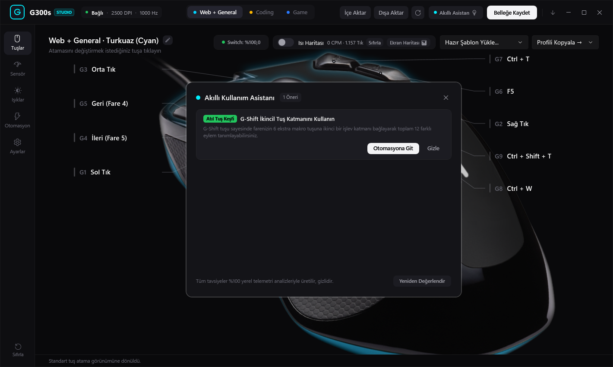

# Logitech G300s Studio

A lightweight, portable controller and firmware management utility for the **Logitech G300s Optical Gaming Mouse** (`VID: 0x046D, PID: 0xC246`).

[](https://github.com/furkan-izgi/logitech-g300s-studio/actions)
[](https://github.com/furkan-izgi/logitech-g300s-studio/releases/latest)
[](LICENSE)
[](https://github.com/furkan-izgi/logitech-g300s-studio)

---

## Overview

Logitech Gaming Software (LGS) is a legacy ~150MB suite that hasn't received meaningful updates for the G300s in years, and Logitech G HUB does not support this mouse at all. 

**Logitech G300s Studio** is a clean, modern replacement built in C# (.NET 10 / WPF). It interacts directly with the mouse's vendor HID endpoint (`0xFF80`), eliminating the need for any Logitech background daemons, drivers, or system hooks.

### [Direct Download: LogitechG300sStudio.exe](https://github.com/furkan-izgi/logitech-g300s-studio/releases/latest/download/LogitechG300sStudio.exe)
> Single-file portable executable (~60MB). Zero installation, no runtime dependencies required. Download and run.

---

## Screenshots

<p align="center">
  
</p>

### Feature Showcases

<table>
  <tr>
    <td align="center" width="50%"><b>Sensör &amp; DPI Kademe Ayarları (250–2500 DPI)</b></td>
    <td align="center" width="50%"><b>RGB Aydınlatma Studio &amp; Renk Profilleri</b></td>
  </tr>
  <tr>
    <td align="center"></td>
    <td align="center"></td>
  </tr>
  <tr>
    <td align="center" width="50%"><b>Otomasyon, Tuş Haritalama &amp; Makro Motoru</b></td>
    <td align="center" width="50%"><b>Omron Mekanik Switch Sağlık &amp; Aşınma Takibi</b></td>
  </tr>
  <tr>
    <td align="center"></td>
    <td align="center"></td>
  </tr>
  <tr>
    <td align="center" width="50%"><b>Ekran Tıklama &amp; Durma Isı Haritası (Heatmap)</b></td>
    <td align="center" width="50%"><b>Fiziksel Donanım Tuş Tıklama Dağılımı</b></td>
  </tr>
  <tr>
    <td align="center"></td>
    <td align="center"></td>
  </tr>
  <tr>
    <td align="center" width="50%"><b>Akıllı Asistan &amp; Telemetri Önerileri</b></td>
    <td align="center" width="50%"><b>Windows 11 Mica / Akrilik &amp; Donanım Ayarları</b></td>
  </tr>
  <tr>
    <td align="center"></td>
    <td align="center"></td>
  </tr>
</table>

---

## Features

* **Onboard Flash Memory Access**: Reads and writes all 3 hardware profiles (`0xF3`, `0xF4`, `0xF5`) directly to the mouse's onboard EEPROM. Handles the hardware busy flag (`0xF0` bit 3) to prevent memory corruption during write operations.
* **Zero-Wear RAM Operations**:
  * **Live LED (`0xF1`)**: Updates the RGB LED color in volatile RAM instantly without burning through EEPROM write cycles.
  * **Live Report Rate (`0xF2`)**: Switches USB polling rates (125, 250, 500, 1000 Hz) on the fly.
* **Ready-to-Use Preset Templates**: One-click game-specific profiles tailored for **Minecraft** (PvP, OptiFine Zoom, F5 Perspective, Off-hand Swap), **League of Legends** (LoL / MOBA Attack Move, Trinket Ward, Recall, Ping Wheel), **Counter-Strike 2** (CS2 Rekabetçi / Quick-Switch, Grenades, Jump-throw, Sniper DPI Shift), **Valorant**, **Apex Legends**, **Fortnite**, **GTA V**, **MMORPGs**, as well as general Web & Development workflows.
* **Switch Health Tracking & Debounce**: Tracks individual actuations for Left, Right, Middle, and G4–G9 buttons against the Omron D2FC 10M lifecycle rating. Includes a software debounce filter to eliminate chatter and accidental double-clicks on aging switches.
* **High Function Keys (`F13`–`F24`)**: Bypasses the mouse's physical boot-keyboard limit by mapping hardware buttons to unassigned virtual keys (`F13..F24`), allowing custom Discord/in-game binds without hijacking standard keyboard shortcuts.
* **Heatmap Analytics**:
  * **Screen Dwell Heatmap**: Visualizes cursor resting zones and spatial click density across multi-monitor setups.
  * **Button Heatmap**: Displays usage distribution across all 9 physical buttons.
* **Smart Telemetry Advisor**: Analyzes active polling rate, sensor tracking stability, and click fatigue in real time to suggest optimal DPI and ergonomic profiles.
* **Windows 11 Integration**: Frameless UI utilizing Windows DWM Mica/Acrylic backdrop materials, native snap layouts, and system tray minimization.

---

## Reverse-Engineered HID Protocol

The mouse exposes a vendor-specific HID usage page (`0xFF80`) with report ID `0x0080`:

| Report ID | Size | Direction | Function |
| :---: | :---: | :---: | :--- |
| `0x80` | 5 Bytes | Input | Asynchronous hardware button press notifications |
| `0xF0` | 4 Bytes | Feature | Read/Write active profile (bits 7..4), DPI level (bits 2..1), and Flash Busy Lock (bit 3) |
| `0xF1` | 2 Bytes | Feature | Volatile RAM RGB LED control (`[0xF1, (r) \| (g << 1) \| (b << 2)]`) |
| `0xF2` | 2 Bytes | Feature | Volatile RAM USB Polling Rate (`[0xF2, 0x04 \| rate_code]`) |
| `0xF3` | 35 Bytes | Feature | Onboard Profile 0 Flash Memory dump / write |
| `0xF4` | 35 Bytes | Feature | Onboard Profile 1 Flash Memory dump / write |
| `0xF5` | 35 Bytes | Feature | Onboard Profile 2 Flash Memory dump / write |

### 35-Byte Onboard Profile Layout
```
Offset  0: Report ID (0xF3, 0xF4, 0xF5)
Offset  1: LED color (bit 0=Red, bit 1=Green, bit 2=Blue)
Offset  2: Report rate code (0=1000Hz, 1=125Hz, 2=250Hz, 3=500Hz)
Offset 3-6: 4 DPI levels (value = (byte & 0x7F) * 250; bit 7 indicates default stage)
Offset  7: Hardware calibration byte (0x40)
Offset 8-34: 9 physical buttons (3 bytes each: [action_code, modifier_mask, hid_key_code])
```

---

## Building from Source

### Prerequisites
* Windows 10/11
* [.NET 10 SDK](https://dotnet.microsoft.com/download/dotnet/10.0)

```powershell
# Clone the repository
git clone https://github.com/furkan-izgi/logitech-g300s-studio.git
cd logitech-g300s-studio

# Build single-file portable executable
dotnet publish native/G300sController/G300sController.csproj `
    -c Release `
    -r win-x64 `
    --self-contained true `
    -p:PublishSingleFile=true `
    -p:IncludeNativeLibrariesForSelfExtract=true `
    -p:IncludeAllContentForSelfExtract=true `
    -p:EnableCompressionInSingleFile=true `
    -o dist/
```
The resulting binary will be created at `dist/LogitechG300sStudio.exe`.

---

## Automated Builds (CI/CD)

Every push to `master` triggers a [GitHub Actions workflow](.github/workflows/build-release.yml) that compiles the standalone executable and automatically updates the [Continuous Release](https://github.com/furkan-izgi/logitech-g300s-studio/releases/tag/latest).

---

## License

[MIT License](LICENSE) &copy; 2026 Furkan İzgi
